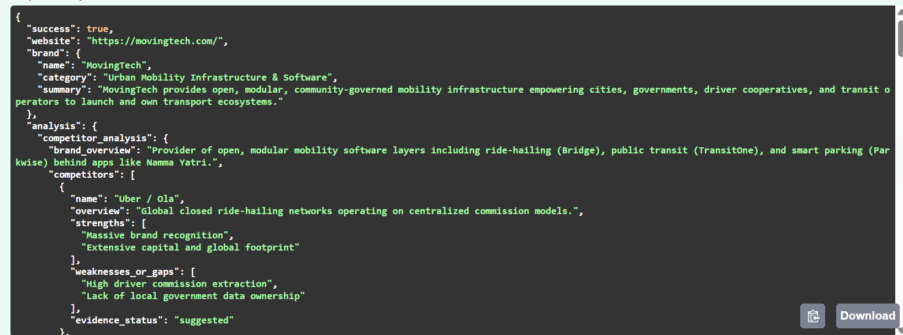
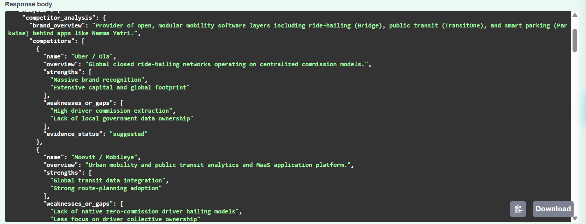

# AI Website Link Analysis API

FastAPI service that fetches a public website, extracts readable page evidence, and asks an LLM to return structured business, competitor, search query, SEO, service, and audience analysis.

## Run locally

Requires Python 3.10 or newer and an API key for an OpenAI-compatible chat completions endpoint.

```powershell
py -m venv .venv
.venv\Scripts\Activate.ps1
pip install -r requirements.txt
Copy-Item .env.example .env
```

Set `LLM_API_KEY` in `.env` to your Google AI Studio API key, then start the server. The configuration is already set to Google's OpenAI-compatible endpoint and `gemini-3.8-flash`.

```powershell
uvicorn app.main:app --host 0.0.0.0 --port 4000 --reload
```

Open interactive API docs at <http://localhost:4000/docs>. Health check: `GET /health`.

## Request

```http
POST http://localhost:4000/link-analysis
Content-Type: application/json
```

```json
{"url":"https://example.com"}
```

The response contains `success`, `website`, `brand`, and `analysis` with five sections: `competitor_analysis`, exactly five `target_search_queries`, `seo_improvements`, exactly five `top_services`, and `target_audience`. The service classification records whether each service was found on the website or inferred. Competitors are labeled `suggested` unless independently verified; this implementation does not perform competitor web research. Search volume and ranking metrics are never fabricated.

Invalid URLs and fetch/SSRF checks return HTTP 422. Missing LLM configuration returns 503; upstream LLM or malformed output returns 502. The API caches completed analyses in process memory for 15 minutes by default. Set `CACHE_TTL_SECONDS=0` to disable reuse. This cache is intentionally small/simple for a practical test; production should use a bounded shared cache with eviction and privacy controls.

## Configuration

| Variable | Default | Purpose |
|---|---|---|
| `LLM_PROVIDER` | `google-ai-studio` | Informational provider setting |
| `LLM_API_KEY` | empty | Google AI Studio API key; never commit `.env` |
| `LLM_MODEL` | `gemini-3.8-flash` | Model name |
| `LLM_BASE_URL` | `https://generativelanguage.googleapis.com/v1beta/openai/` | Gemini OpenAI-compatible API base |
| `LLM_TIMEOUT_SECONDS` | `180` | LLM request timeout |
| `MAX_PAGE_BYTES` | `2000000` | Maximum HTML download size |
| `MAX_CONTENT_CHARS` | `18000` | Maximum extracted text sent for analysis |
| `CACHE_TTL_SECONDS` | `900` | In-memory cache lifetime |

The extractor blocks non-public IP addresses, resolves hostnames before every request, checks every redirect, limits response size, and accepts only HTML. As with any URL fetcher, production deployment should additionally use an egress firewall/network policy that denies private and metadata ranges to defend against DNS rebinding and infrastructure changes between validation and connection.

## Sample response

This compact example is based on a successful local analysis of MovingTech. It preserves the response shape and exactly five search queries and services. Competitor entries are AI-generated suggestions, not independently researched claims.

```json
{
  "success": true,
  "website": "https://movingtech.com/",
  "brand": {
    "name": "MovingTech",
    "category": "Urban Mobility Infrastructure & Software",
    "summary": "Open, modular mobility infrastructure for cities, governments, driver cooperatives, and transit operators."
  },
  "analysis": {
    "competitor_analysis": {
      "brand_overview": "Open infrastructure for community-governed ride-hailing and multimodal transit.",
      "competitors": [
        {"name":"Uber","overview":"Global ride-hailing and delivery platform.","strengths":["Global brand","Large network"],"weaknesses_or_gaps":["Not locally governed","Commission-based model"],"evidence_status":"suggested"},
        {"name":"Ola","overview":"Ride-hailing aggregator with cab and auto services.","strengths":["Established brand","Broad city presence"],"weaknesses_or_gaps":["Centralized platform","Commission-based model"],"evidence_status":"suggested"},
        {"name":"Moovit","overview":"Public transit and journey-planning provider.","strengths":["Transit coverage","Journey planning"],"weaknesses_or_gaps":["Different focus from community-governed ride-hailing"],"evidence_status":"suggested"}
      ],
      "strengths": ["Community-governed model","Ride-hailing, transit, and parking products"],
      "opportunities": ["Expand in Nordic and European markets","Integrate with municipal smart-city systems"]
    },
    "target_search_queries": [
      {"query":"open mobility infrastructure for cities","platforms":["Google","LinkedIn"],"intent":"Commercial","business_relevance":"Matches city mobility procurement needs.","target_audience":"City transport planners"},
      {"query":"zero commission ride hailing software","platforms":["Google","LinkedIn","X"],"intent":"Commercial","business_relevance":"Relevant to independent ride-hailing networks.","target_audience":"Driver cooperatives and fleet operators"},
      {"query":"multimodal transit ticketing platform","platforms":["Google","LinkedIn"],"intent":"Commercial","business_relevance":"Matches transit digitization needs.","target_audience":"Transit agencies"},
      {"query":"open source public transport app framework","platforms":["Google","X"],"intent":"Informational","business_relevance":"Reaches teams evaluating open mobility systems.","target_audience":"Developers and smart-city teams"},
      {"query":"smart parking and urban mobility integration","platforms":["Google","LinkedIn"],"intent":"Commercial","business_relevance":"Connects parking operations with city mobility.","target_audience":"Municipalities and venue operators"}
    ],
    "seo_improvements": {
      "primary_keyword":"mobility infrastructure for cities",
      "secondary_keywords":["zero commission ride hailing","open transit platform"],
      "long_tail_keywords":["multimodal public transit ticketing software for cities"],
      "business_keywords":["TransitOne","Parkwise smart parking","Bridge ride hailing"],
      "recommended_title":"Mobility Infrastructure for Cities & Communities | MovingTech",
      "title_keyword":"Mobility Infrastructure for Cities",
      "title_structure":"Primary keyword | Brand name",
      "meta_description":"Empower your city with open mobility infrastructure for ride-hailing, transit, and smart parking.",
      "supporting_content":["City case studies","Transit implementation guides","Product API documentation"]
    },
    "top_services": [
      {"service_name":"Bridge (Hyperlocal Ride-Hailing)","description":"Infrastructure for locally operated ride-hailing networks.","target_industry":"Urban transportation","target_customer":"Driver cooperatives and fleet operators","main_benefit":"Locally governed operations.","evidence_status":"website"},
      {"service_name":"TransitOne (Unified Public Transport)","description":"Journey planning and ticketing across public transport.","target_industry":"Public transit","target_customer":"City transport authorities","main_benefit":"Connected multimodal journeys.","evidence_status":"website"},
      {"service_name":"Parkwise (Smart Parking Infrastructure)","description":"Digital parking access and ecosystem integration.","target_industry":"Smart infrastructure","target_customer":"Municipalities and venue operators","main_benefit":"Simplified parking operations.","evidence_status":"website"},
      {"service_name":"CityPulse (Urban Experience Platform)","description":"Digital platform for city travel and experiences.","target_industry":"Smart cities and urban tourism","target_customer":"City governments and tourism boards","main_benefit":"Connected city services.","evidence_status":"website"},
      {"service_name":"Propel & Tandem (Strategy & Operations)","description":"Launch strategy and operational support for mobility networks.","target_industry":"Mobility technology","target_customer":"Mobility startups and agencies","main_benefit":"Support from launch through growth.","evidence_status":"website"}
    ],
    "target_audience": {
      "primary_audience":[{"audience":"City and municipal governments","business_type":"Public-sector transport departments","requirement":"Integrated, locally controlled mobility systems.","customer_profile":"Transport planners and municipal leaders."}],
      "secondary_audience":[{"audience":"Driver collectives and unions","business_type":"Driver cooperatives","requirement":"Community-governed ride-hailing software.","customer_profile":"Cooperative leaders and fleet operators."}],
      "industries":["Urban mobility","Public transit","GovTech","Smart cities"],
      "business_types":["Government transport authorities","Driver cooperatives","Transit agencies"],
      "geographic_focus":"Global, with established use in India and expansion in the Nordics.",
      "customer_needs":["Local control","Integrated transit","Lower platform fees"],
      "interests":["Open mobility systems","Smart cities","EV integration"],
      "recommended_segments":["City transport departments","Regional driver unions","Transit corporations"]
    }
  }
}
```

## LLM comparison and recommendation

**Recommended model for this implementation: Google Gemini 3.8 Flash.** It is configured in the app and successfully analyzed a real business website using the user's AI Studio key. Google documents structured output support and a 1,048,576-token input limit. Large context is not necessary here because extracted page text is capped at 18,000 characters. This is the practical choice for the current setup; it has not been proven more accurate than the alternatives.

| Provider/model | Standard API price per 1M tokens (input / output) | Context and JSON support | Speed and accuracy evidence | Suitability |
|---|---:|---|---|---|
| Google Gemini 3.8 Flash | $0.75 / $3.75 through Dec 31, 2026; $1.50 / $7.50 from Jan 1, 2027 | 1,048,576 input tokens; structured output supported | Google describes it as its most capable Flash model. No comparative benchmark or app latency was recorded. | Current configured model; already validated in one real-site run. |
| OpenAI GPT-6 Luna | $0.10 / $0.50 | 1.05M context; structured outputs supported | OpenAI positions it for efficient high-volume tasks. No project-specific accuracy or latency measurement. | Lower-cost alternative; requires an OpenAI key and corresponding config. |
| Anthropic Claude Haiku 5.5 | $0.10 / $0.50 up to 100K prompt tokens; $0.50 / $2.50 above 100K | 1M context; structured outputs supported | Anthropic labels it fastest in its current model family. No project-specific accuracy or latency measurement. | Candidate for high-volume analysis; requires an Anthropic API adapter/key rather than the current Gemini endpoint. |

At an estimated 8,000 input and 2,500 output tokens, Gemini 3.8 Flash costs about **$0.0154 per analysis** at current introductory rates (`0.008 × $0.75 + 0.0025 × $3.75`). At the rates scheduled from Jan 1, 2027, the same token estimate costs about **$0.0308**. Output pricing includes thinking tokens. These are estimates, not metered request data; actual use varies by website, schema, thinking, and response length.

**Response time:** No duration was recorded for the successful local request, so there is no measured or defensible expected latency yet. The configured 180 seconds is a timeout ceiling, not an expected response time. Record at least 20 runs across representative websites and report median and p95 before making a speed claim.

**Accuracy:** No comparative benchmark was run. Evaluate the models on a labeled set spanning industries, page sizes, and languages. Score brand/service extraction, factual grounding, query relevance, audience relevance, and schema validity. Competitor identities and strengths are marked `suggested` because this implementation does not perform external competitor research.

**Fallback:** GPT-6 Luna is the closest low-cost fallback candidate. It can use the OpenAI-compatible structured-output flow, but you would need an OpenAI key and would need to update the model/base URL configuration. Claude Haiku 5.5 is another candidate but needs its own provider integration.

## Cost optimization

Implemented: remove non-content HTML, cap extracted text at 18,000 characters, use one concise schema-constrained LLM call, cap output at 4,096 tokens, and cache successful analyses by website URL and model. Additional production options include bounded shared caching, measuring provider token usage, rate limiting, and testing smaller models against the same labeled set. Do not report search volumes or rankings without a real keyword data provider.

Pricing and model capabilities checked 19 November 2026. Rates and model availability change. Sources: [Gemini 3.8 Flash model details](https://aistudio.google.com/docs/models/gemini-3.8-flash), [Gemini 3.8 Flash pricing](https://aistudio.google.com/docs/pricing#gemini-3.8-flash), [Gemini structured output](https://ai.google.dev/gemini-api/docs/openai#structured-output), [OpenAI GPT-6 Luna](https://developers.openai.com/api/docs/models/gpt-6-luna) and [OpenAI pricing](https://developers.openai.com/api/docs/pricing), [Claude Haiku 5.5](https://platform.claude.com/docs/en/models/haiku-5-5/overview).
## Notes and limitations

- Single-page extraction may miss dynamically rendered content, linked pages, and facts behind access controls.
- The LLM interprets supplied text; it does not independently validate claims or identify competitors from research sources.
- The cache is per-process and memory-only. Do not run multiple workers expecting shared caching.
- Keep API keys in environment variables or a secret manager. Never commit credentials.
- Before publishing, add rate limiting, observability, bounded cache eviction, and an egress firewall.

## Live demo

- **Live service:** <https://python-practical-test-link-analysis.onrender.com/>
- **API endpoint:** <https://python-practical-test-link-analysis.onrender.com/link-analysis>
- **Interactive API docs:** <https://python-practical-test-link-analysis.onrender.com/docs>
- **Health check:** <https://python-practical-test-link-analysis.onrender.com/health>

The Render free instance may spin down after inactivity, so its first request after a quiet period can take longer to respond.

## Screenshots

Screenshots from a successful local `POST /link-analysis` run against MovingTech:




